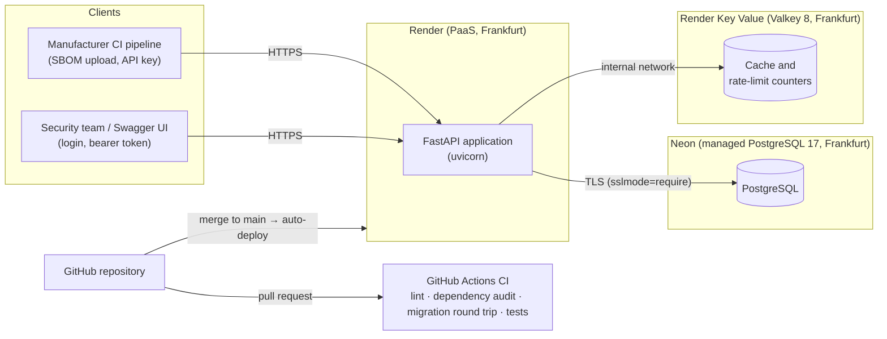

# SBOM Tracker

An API-only backend that helps product manufacturers keep track of the software components inside their products and the known vulnerabilities affecting them, with a focus on the reporting deadlines of the EU Cyber Resilience Act (CRA, Article 14).

Manufacturers upload a Software Bill of Materials (SBOM) for each product version. The backend matches the listed components against public vulnerability data (OSV, CISA KEV) and tracks findings and CRA reporting deadlines.

- **Live API (Swagger UI):** https://sbom-tracker.onrender.com
- **ER model:** [docs/er-model.md](docs/er-model.md)
- **Threat model:** [docs/threat-model.md](docs/threat-model.md)
- **Implemented security measures:** [docs/security-measures.md](docs/security-measures.md)

> **Project status:** work in progress. Implemented: authentication and organisation roles, products and versions, CI API keys, SBOM upload, OSV and CISA KEV import, vulnerability matching that creates findings, a paginated findings list, triage as a state machine, a cached exposure summary per product, and an audit log. CRA deadline tracking is listed below as *planned*. This README is updated as features are merged.

### Guide for assessors

| Module | Where to look |
|---|---|
| Web Backend Technologies (SE_46) | [Architecture](#architecture), [Tech stack](#tech-stack), [Use cases](#use-cases), [Caching](#caching-exposure-summary), [Load tests](docs/load-tests.md), [Observability](#observability), [Deployment](#deployment), live API: https://sbom-tracker.onrender.com |
| Databases | [Database](#database), [Query optimisation](#query-optimisation-matching-lookup), [Advanced SQL](#advanced-sql-exposure-summary), [Backup and restore drill](docs/backup-restore.md), [Data](#data), [ER model](docs/er-model.md) |
| Cyber Security | [Security](#security), [Threat model](docs/threat-model.md), [Implemented measures](docs/security-measures.md) |

---

## Use cases

| # | Use case | Status |
|---|---|---|
| UC1 | Sign in; roles (admin, analyst, viewer) per organisation | **Implemented:** login returns a signed access token; `GET /auth/me`; organisation-scoped role checks (viewer < analyst < admin); login rate limiting |
| UC2 | Manage products and product versions | **Implemented:** create and list products and versions per organisation (admin creates, any member reads) |
| UC3 | Upload a CycloneDX SBOM for a product version (CI pipeline, API key) | **Implemented:** `PUT /ci/products/{id}/versions/{version}/sbom` with `X-API-Key`; components read from purls (PyPI, npm, Maven); replaces the version's component list; creates the version if needed; 5 MB limit |
| UC4 | Sync vulnerability data from OSV and CISA KEV | **Implemented:** OSV import (PyPI) via `python -m app.vulnerabilities.import_osv`, creating, updating or skipping records by `modified_at`; CISA KEV marking via `python -m app.vulnerabilities.mark_kev`, mirroring the current catalogue exactly |
| UC5 | Match components against affected version ranges, creating findings | **Implemented:** version rules per ecosystem (PEP 440 for PyPI, SemVer for npm); PyPI names normalised per PEP 503; one finding per version / component / vulnerability; re-matching never changes existing findings |
| UC6 | Browse findings with filtering, sorting and pagination | **Implemented:** `GET /organizations/{id}/findings` |
| UC7 | Triage findings through defined states (new → investigating → affected / not affected → fixed) | **Implemented:** `POST /organizations/{id}/findings/{finding_id}/triage` (analyst and above); allowed transitions defined as a state machine; `not_affected` requires a justification; who triaged is recorded |
| UC8 | Track CRA Article 14 deadlines (24 h / 72 h / 14 days) for exploited, affected findings | Planned (schema implemented) |
| UC9 | Exposure summary per product (cached) | **Implemented:** `GET /organizations/{id}/exposure`, one hand-written SQL query; cached in Redis (Valkey) per organisation, invalidated on SBOM upload, triage and product creation, 5-minute TTL |
| UC10 | Audit log of security-relevant actions | **Implemented:** logins (success and failure), SBOM uploads, triage decisions and API key creation / revocation are recorded in the same transaction as the action; admins read their organisation's log via `GET /organizations/{id}/audit-log` (paginated, newest first); append-only |

**When matching runs (UC5):**
- Automatically after every SBOM upload (`PUT /ci/products/{id}/versions/{version}/sbom`), in the same transaction. The response reports `findings_created`.
- After a vulnerability sync, re-match all versions with an SBOM: `python -m app.matching.rematch`

**Findings list (UC6):** `GET /organizations/{id}/findings`, readable by every member. Known-exploited findings first, then newest; filters `status`, `product_id`, `known_exploited`; pagination with `limit` (1–100, default 50) and `offset`, plus `total` in the response.

**Triage (UC7):** every verdict passes through `investigating`; reopening a decided finding returns it to `investigating`, never to `new`. Forbidden transitions return 409 and change nothing. `not_affected` without a justification returns 422 (as in VEX, a "not affected" claim needs a reason).

**Audit log (UC10):** entries are written in the same transaction as the action they record, so a rejected action leaves no entry. Details are stored as JSONB (for example the old and new status of a triage). Passwords, tokens and API keys are never logged; a failed login records only the attempted email (lowercased, at most 320 characters). Login events belong to no organisation and are therefore not shown in the admin view.

---

## Architecture



- **Architecture style:** a modular monolith. One FastAPI application, structured by domain (`app/auth`, `app/products`, `app/sboms`, `app/vulnerabilities`, `app/matching`, `app/findings`, `app/exposure`, `app/audit`, `app/models`). The vulnerability sync runs as command-line jobs; a scheduled background job is planned.
- **Code layers:** HTTP routers (thin) → services and queries (logic) → SQLAlchemy models / database. Dependencies such as the database session, the cache and settings are injected with FastAPI's `Depends`.
- **Stateless:** identity lives in signed tokens, data in PostgreSQL, cache and rate-limit counters in Redis, so any process or instance can serve any request. See [Load tests](docs/load-tests.md) for the measured effect of caching and of running several processes.

## Tech stack

| Layer | Choice | Why |
|---|---|---|
| Language | Python 3.12 | Strong domain libraries for version handling and SBOM formats; mature ORM and migration tooling |
| Framework | FastAPI | Input validation via Pydantic, automatic OpenAPI / Swagger docs, dependency injection |
| Database | PostgreSQL 17 | Relational data with many relationships, strong constraints, transactional DDL, advanced index types |
| ORM / migrations | SQLAlchemy 2.1, Alembic | Typed models; versioned, reviewable schema migrations |
| Cache | Valkey 8 (Render Key Value; Docker locally), redis-py | Redis-compatible open-source fork; exposure summary cache and shared login rate-limit counters |
| Auth | Argon2id (argon2-cffi), JWT HS256 (PyJWT), `limits` | Current password-hashing recommendation; standard, library-based tokens; login rate limiting |
| Version handling | `packaging` (PEP 440), `semver` (SemVer 2.0), `packageurl-python` | Reference implementations of each ecosystem's version and package-URL rules |
| Quality | Ruff (lint, format, security rules), pytest, pip-audit, Locust | One fast tool for style and static checks; isolated database tests; known-vulnerability scan of dependencies; load tests |
| CI | GitHub Actions, Dependabot | Lint, dependency audit, migration round trip and tests (with PostgreSQL and Valkey services) on every pull request; weekly update proposals |
| Hosting | Render (Starter web service, Free Key Value), Neon (Free) | PaaS with HTTPS and auto-deploy; managed PostgreSQL with point-in-time restore |

---

## Database

- **Schema:** 14 tables. See the [ER model](docs/er-model.md) for entities, keys, cardinalities and constraints.
- **Many-to-many relationships:**
  - `users` ↔ `organizations` via `memberships` (with a role per membership)
  - `product_versions` ↔ `components` via `version_components`
  - `findings` links product versions, components and vulnerabilities
- **Integrity rules in the database itself:**
  - composite unique constraints (e.g. one finding per version / component / vulnerability)
  - enums for roles and finding status
  - foreign keys with deliberately chosen `ON DELETE` rules: `CASCADE` for owned data, `SET NULL` for "triaged by", and no deletion of anything referenced by the audit log
- **Constraint naming convention:** every constraint and index gets a predictable name (`uq_…`, `fk_…`, `pk_…`, `ix_…`), so future migrations and error handling can refer to them reliably.
- **Migrations:** Alembic. The initial migration was reviewed by hand and extended to drop enum types on downgrade. A data migration normalises existing PyPI package names (one set-based `UPDATE`). CI runs a full `upgrade → downgrade → upgrade` round trip on every pull request.
- **Data access:** SQLAlchemy sessions, one per request, injected via `Depends(get_session)`. Connection pooling with `pool_pre_ping`.
- **Transactions:** SBOM upload and matching commit together or not at all; audit entries commit together with the action they record; the OSV import commits one transaction per batch of 500 records.
- **Indexes:** primary keys and unique constraints are indexed; a composite index serves the matching lookup (measured below); `(organization_id, occurred_at)` serves the audit log. Further advanced indexes (partial, GIN) are planned.
- **Semi-structured data:** audit entry details are stored as JSONB.
- **Backups:** the production database runs on Neon, which provides continuous point-in-time restore (6-hour history window on the free plan). A **restore drill** was carried out on 24 November 2026: data deleted on purpose was recovered on a branch restored to the second before the deletion. See [docs/backup-restore.md](docs/backup-restore.md).

### Query optimisation: matching lookup

Matching loads all affected ranges for a version's packages with one query:
`WHERE (ecosystem, package_name) IN (...)`. A composite B-tree index
`ix_affected_ranges_ecosystem_package_name` serves it (ecosystem first, so
ecosystem-only queries can use the leftmost prefix).

`EXPLAIN ANALYZE`, 4 packages, ~30,650 ranges (single run, local Docker, PostgreSQL 17):

| | Plan | Rows removed by filter | Execution time |
|---|---|---|---|
| Without index | Seq Scan | 29,738 | 11.57 ms |
| With index | Bitmap Index Scan ×4 → BitmapOr → Bitmap Heap Scan | 0 | 0.81 ms |

Trade-off: the OSV import must also maintain the index on every insert.

### Advanced SQL: exposure summary

`GET /organizations/{id}/exposure` returns one row per product: its latest uploaded version and the open findings of that version, by severity and exploitation status. It is one hand-written query ([`app/exposure/queries.py`](app/exposure/queries.py)) with bound parameters:

- **CTE + window function:** `ROW_NUMBER() OVER (PARTITION BY product_id ORDER BY sbom_uploaded_at DESC, id DESC)` picks each product's latest version
- **Conditional aggregation:** `count(...) FILTER (WHERE ...)` computes four counts in one pass
- **LEFT JOINs:** products without an SBOM or without findings are still listed, with zeros (`count(column)` rather than `count(*)`, so the NULL row from the outer join is not counted)
- **Ordering:** most exploited first, then most critical, then most open findings

Only the latest version counts, because older versions are no longer shipped and would otherwise inflate a product's exposure.

### Caching: exposure summary

The exposure query runs on every request, but its result only changes when data changes. It is cached with **cache-aside** ([`app/exposure/service.py`](app/exposure/service.py)):

- Key per organisation (`exposure:{organization_id}`), so no tenant can be served another tenant's summary
- **Invalidation after commit** on SBOM upload, triage and product creation; a 5-minute TTL as a safety net
- After a vulnerability sync (`rematch`), summaries may be up to 5 minutes old (accepted trade-off)
- **Graceful degradation:** if the cache is unreachable, the API falls back to the database and logs a warning; without `REDIS_URL` (or with an empty value) the app runs without a cache
- The cache is behind a `Cache` protocol, so tests use an in-memory fake; the Redis implementation is tested against a real Valkey in CI
- **Measured effect** (local load test, 1 process): 95th percentile of all requests 480 ms without cache, 290 ms with cache; with 4 processes and the shared cache, 63 ms. See [docs/load-tests.md](docs/load-tests.md).

### Data

| Data | Source | Amount (current) |
|---|---|---|
| Organisations, users, memberships | `python -m app.seed`: deterministic demo data, idempotent, one transaction | 1 organisation, 3 users (one per role) |
| Vulnerabilities, aliases, affected ranges | OSV.dev PyPI export (`all.zip`), imported with `python -m app.vulnerabilities.import_osv` | 27,069 vulnerabilities, 36,158 aliases, 30,653 affected ranges (local import, Nov 2026). First import 29 s; idempotent re-run 19 s with every record unchanged |
| Components / SBOMs | Uploaded through the API like a CI pipeline would; SBOMs generated with Syft from real container images | Upload implemented (UC3); bulk import of real SBOMs planned |
| Findings, report cases | Produced by the application's matching logic: after every SBOM upload, and with `python -m app.matching.rematch` after a sync | Findings implemented (UC5, UC6, UC7); report cases planned (UC8) |
| Known exploited vulnerabilities | CISA KEV catalogue (JSON), matched through CVE aliases. ENISA also aggregates CISA KEV into the EUVD; the marking logic only needs "CVE → date added", so the EU KEV catalogue can be added as a second source | 1,790 KEV entries → 47 vulnerabilities marked (Nov 2026), in 1.2 s with three set-based SQL statements |
| Load-test data (local only) | `python -m loadtests.seed_load_data`: 20 products with SBOMs of old package versions; refuses non-local databases | Used for the [load tests](docs/load-tests.md) |

**Sync order.** After new vulnerability data arrives, run the three steps in this order, so that matching sees the newest records and KEV marks:
`python -m app.vulnerabilities.import_osv` → `python -m app.vulnerabilities.mark_kev` → `python -m app.matching.rematch`

Passwords for seeded users are never stored in the code. They come from `DEMO_PASSWORD` in the environment and are stored as Argon2id hashes.

---

## Security

- **Threat model (STRIDE):** [docs/threat-model.md](docs/threat-model.md)
- **Implemented measures:** [docs/security-measures.md](docs/security-measures.md)

---

## Running locally

**Prerequisites:** Python 3.12, Docker with Docker Compose, Git.

```bash
git clone git@github.com:eterna09/sbom-tracker.git
cd sbom-tracker

python3.12 -m venv .venv
source .venv/bin/activate
pip install -r requirements-dev.txt

cp .env.example .env
# Edit .env: set your own passwords, and generate a signing key with:
#   python -c "import secrets; print(secrets.token_urlsafe(64))"
```

**Database and cache** (PostgreSQL 17 and Valkey 8 in Docker, reachable only from localhost on ports 5433 and 6379):

```bash
docker compose up -d
alembic upgrade head
python -m app.seed
```

**Run the API:**

```bash
uvicorn app.main:app --reload
```

Open http://localhost:8000. It redirects to the Swagger UI. Log in via `POST /auth/token` with `admin@acme.example` and your `DEMO_PASSWORD`.

## Tests and code quality

```bash
docker compose exec db createdb -U sbom sbom_tracker_test   # once
pytest -v
ruff check .
ruff format --check .
pip-audit -r requirements.txt
```

Tests run against a separate test database. Each test runs inside a transaction that is rolled back afterwards, so tests never see each other's data. API tests use an in-memory cache; the Redis tests (cache and shared rate-limit counters) use database 1 of the local Valkey (`TEST_REDIS_URL`) and are skipped if it is not set.

**Load tests** use Locust from a separate virtual environment (`requirements-load.txt`); scenario, commands and results are in [docs/load-tests.md](docs/load-tests.md).

## Deployment

- **Render** web service (Starter, Frankfurt), auto-deployed on every merge to `main`.
  - Pre-deploy command: `alembic upgrade head`
  - Start command: `uvicorn app.main:app --host 0.0.0.0 --port $PORT --proxy-headers --forwarded-allow-ips="*" --no-access-log`
  - Health check: `/health/ready` (app running **and** database reachable)
  - Secrets (`DATABASE_URL`, `JWT_SECRET_KEY`), `REDIS_URL` and `RATE_LIMIT_STORAGE_URL` are stored as Render environment variables, separate from development values.
- **Neon** PostgreSQL 17 (Frankfurt), direct TLS connection.
- **Render Key Value** (Free, Valkey 8, Frankfurt, `allkeys-lru`), reached through its internal URL; external access disabled. Holds the exposure cache and the login rate-limit counters.

## Observability

- **Structured logs:** every log line is one JSON object on stdout (collected by Render). Each request gets one line with `request_id`, `method`, `path` (without query string), `status` and `duration_ms`; the same id is returned in the `X-Request-ID` response header, so a reported error can be traced to its log line.
- **No credentials in logs:** headers, request bodies and query strings are never logged (tested); uvicorn's own access log is disabled (`--no-access-log`).
- **Security events:** requests blocked by the login rate limit are logged as warnings (client IP, no email or password); an unreachable rate-limit store is logged as an error. Logins, uploads, triage and API key changes are in the [audit log](#use-cases).
- **Monitoring:** an external uptime monitor calls `/health/ready` (app **and** database) every 5 minutes and alerts by email; Render shows CPU, memory and request metrics.
- **Log level:** `LOG_LEVEL` environment variable (default `INFO`).

## Development workflow

GitHub Flow: short-lived branches, pull requests with green CI, merge commits that keep the individual atomic commits visible, and conventional commit prefixes (`feat`, `fix`, `test`, `refactor`, `docs`, `chore`, `style`, `ci`, `perf`). New behaviour is specified test-first where practical; the history shows test commits followed by implementation commits, and planned refactorings (smell → refactoring, tests unchanged) as separate `refactor` commits.
