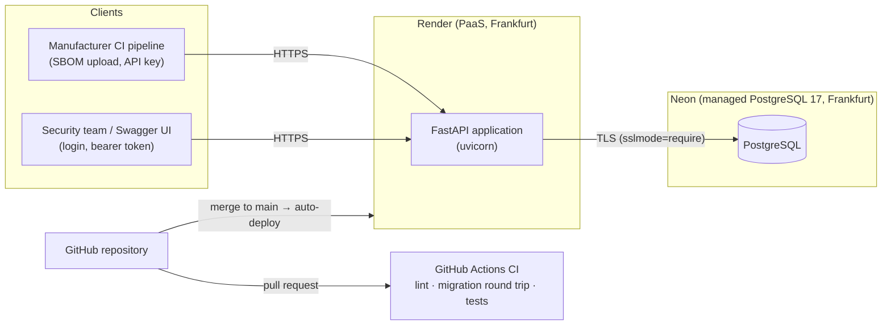

# SBOM Tracker

An API-only backend that helps product manufacturers keep track of the software components inside their products and the known vulnerabilities affecting them, with a focus on the reporting deadlines of the EU Cyber Resilience Act (CRA, Article 14).

Manufacturers upload a Software Bill of Materials (SBOM) for each product version. The backend matches the listed components against public vulnerability data (OSV, CISA KEV) and tracks findings and CRA reporting deadlines.

- **Live API (Swagger UI):** https://sbom-tracker.onrender.com
- **ER model:** [docs/er-model.md](docs/er-model.md)
- **Threat model:** [docs/threat-model.md](docs/threat-model.md)
- **Implemented security measures:** [docs/security-measures.md](docs/security-measures.md)

> **Project status:** work in progress. The database schema, authentication (login with signed access tokens), CI and deployment are implemented. Most domain use cases are designed and listed below as *planned*. This README is updated as features are merged.

### Guide for assessors

| Module | Where to look |
|---|---|
| Web Backend Technologies (SE_46) | [Architecture](#architecture), [Tech stack](#tech-stack), [Deployment](#deployment), live API: https://sbom-tracker.onrender.com |
| Databases | [Database](#database), [Data](#data), [ER model](docs/er-model.md), [Use cases](#use-cases) |
| Cyber Security | [Security](#security), [Threat model](docs/threat-model.md), [Implemented measures](docs/security-measures.md) |

---

## Use cases

| # | Use case | Status |
|---|---|---|
| UC1 | Sign in; roles (admin, analyst, viewer) per organisation | **Implemented:** login returns a signed access token; `GET /auth/me`; organisation-scoped role checks (viewer < analyst < admin) |
| UC2 | Manage products and product versions | **Implemented:** create and list products and versions per organisation (admin creates, any member reads) |
| UC3 | Upload a CycloneDX SBOM for a product version (CI pipeline, API key) | **Implemented:** `PUT /ci/products/{id}/versions/{version}/sbom` with `X-API-Key`; components read from purls (PyPI, npm, Maven); replaces the version's component list; creates the version if needed; 5 MB limit |
| UC4 | Sync vulnerability data from OSV and CISA KEV | Planned (schema implemented) |
| UC5 | Match components against affected version ranges, creating findings | Planned (schema implemented) |
| UC6 | Browse findings with filtering, sorting and pagination | Planned |
| UC7 | Triage findings through defined states (new → investigating → affected / not affected → fixed) | Planned (schema implemented) |
| UC8 | Track CRA Article 14 deadlines (24 h / 72 h / 14 days) for exploited, affected findings | Planned (schema implemented) |
| UC9 | Exposure summary per product (cached) | Planned |
| UC10 | Audit log of security-relevant actions | Planned (schema implemented) |

---

## Architecture



- **Architecture style:** a modular monolith. One FastAPI application, structured by domain (`app/auth`, `app/models`, …). A background worker for the vulnerability sync is planned.
- **Code layers:** HTTP routers (thin) → services (logic) → SQLAlchemy models / database. Dependencies such as the database session and settings are injected with FastAPI's `Depends`.

## Tech stack

| Layer | Choice | Why |
|---|---|---|
| Language | Python 3.12 | Strong domain libraries for version handling and SBOM formats; mature ORM and migration tooling |
| Framework | FastAPI | Input validation via Pydantic, automatic OpenAPI / Swagger docs, dependency injection |
| Database | PostgreSQL 17 | Relational data with many relationships, strong constraints, transactional DDL, advanced index types |
| ORM / migrations | SQLAlchemy 2.0, Alembic | Typed models; versioned, reviewable schema migrations |
| Auth | Argon2id (argon2-cffi), JWT HS256 (PyJWT) | Current password-hashing recommendation; standard, library-based tokens |
| Quality | Ruff (lint, format, security rules), pytest | One fast tool for style and static checks; isolated database tests |
| CI | GitHub Actions | Lint, migration round trip and tests on every pull request |
| Hosting | Render (Starter), Neon (Free) | PaaS with HTTPS and auto-deploy; managed PostgreSQL with point-in-time restore |

---

## Database

- **Schema:** 14 tables. See the [ER model](docs/er-model.md) for entities, keys, cardinalities and constraints.
- **Many-to-many relationships:**
  - `users` ↔ `organizations` via `memberships` (with a role per membership)
  - `product_versions` ↔ `components` via `version_components`
  - `findings` links product versions, components and vulnerabilities
- **Integrity rules in the database itself:**
  - composite unique constraints (e.g. one finding per version / component / vulnerability)
  - enums for roles and finding status
  - foreign keys with deliberately chosen `ON DELETE` rules: `CASCADE` for owned data, `SET NULL` for "triaged by", and no deletion of anything referenced by the audit log
- **Constraint naming convention:** every constraint and index gets a predictable name (`uq_…`, `fk_…`, `pk_…`, `ix_…`), so future migrations and error handling can refer to them reliably.
- **Migrations:** Alembic. The initial migration was reviewed by hand and extended to drop enum types on downgrade. CI runs a full `upgrade → downgrade → upgrade` round trip on every pull request.
- **Data access:** SQLAlchemy sessions, one per request, injected via `Depends(get_session)`. Connection pooling with `pool_pre_ping`.
- **Indexes:** primary keys and unique constraints are indexed. Advanced indexes (composite, partial, GIN) with `EXPLAIN ANALYZE` evidence are planned once real data volumes exist.
- **Backups:** the production database runs on Neon, which provides continuous point-in-time restore (6-hour history window on the free plan). A documented restore test is planned.

### Data

| Data | Source | Amount (current) |
|---|---|---|
| Organisations, users, memberships | `python -m app.seed`: deterministic demo data, idempotent, one transaction | 1 organisation, 3 users (one per role) |
| Vulnerabilities, aliases, affected ranges | OSV.dev export + CISA KEV feed | Planned (UC4) |
| Components / SBOMs | Uploaded through the API like a CI pipeline would; SBOMs generated with Syft from real container images | Upload implemented (UC3); bulk import of real SBOMs planned |
| Findings, report cases | Produced by the application's matching logic | Planned (UC5, UC8) |

Passwords for seeded users are never stored in the code. They come from `DEMO_PASSWORD` in the environment and are stored as Argon2id hashes.

---

## Security

- **Threat model (STRIDE):** [docs/threat-model.md](docs/threat-model.md)
- **Implemented measures:** [docs/security-measures.md](docs/security-measures.md)

---

## Running locally

**Prerequisites:** Python 3.12, Docker with Docker Compose, Git.

```bash
git clone git@github.com:eterna09/sbom-tracker.git
cd sbom-tracker

python3.12 -m venv .venv
source .venv/bin/activate
pip install -r requirements-dev.txt

cp .env.example .env
# Edit .env: set your own passwords, and generate a signing key with:
#   python -c "import secrets; print(secrets.token_urlsafe(64))"
```

**Database** (PostgreSQL 17 in Docker, reachable only from localhost on port 5433):

```bash
docker compose up -d
alembic upgrade head
python -m app.seed
```

**Run the API:**

```bash
uvicorn app.main:app --reload
```

Open http://localhost:8000. It redirects to the Swagger UI. Log in via `POST /auth/token` with `admin@acme.example` and your `DEMO_PASSWORD`.

## Tests and code quality

```bash
docker compose exec db createdb -U sbom sbom_tracker_test   # once
pytest -v
ruff check .
ruff format --check .
```

Tests run against a separate test database. Each test runs inside a transaction that is rolled back afterwards, so tests never see each other's data.

## Deployment

- **Render** web service (Starter, Frankfurt), auto-deployed on every merge to `main`.
  - Pre-deploy command: `alembic upgrade head`
  - Health check: `/health/ready` (app running **and** database reachable)
  - Secrets (`DATABASE_URL`, `JWT_SECRET_KEY`) are stored as Render environment variables, separate from development secrets.
- **Neon** PostgreSQL 17 (Frankfurt), direct TLS connection.

## Development workflow

GitHub Flow: short-lived branches, pull requests with green CI, merge commits that keep the individual atomic commits visible, and conventional commit prefixes (`feat`, `fix`, `test`, `refactor`, `docs`, `chore`, `style`, `ci`). New behaviour is specified test-first where practical; the history shows test commits followed by implementation commits.
