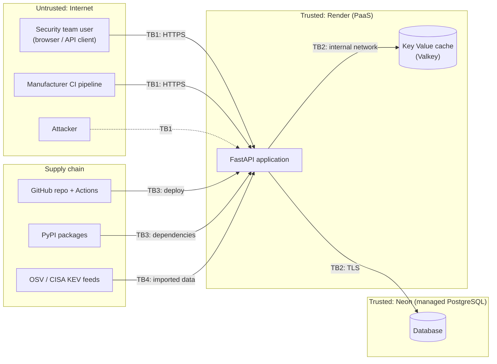

# Threat Model

Method: **STRIDE** (Spoofing, Tampering, Repudiation, Information disclosure, Denial of service, Elevation of privilege), applied per trust boundary.

Status legend: **Implemented**, **Partly**, **Planned**. This document reflects the current state of the code and is updated as features are merged.

## 1. System overview

**Trust boundaries:**
- **TB1:** Internet → API. All client input is untrusted.
- **TB2:** API → data stores: the database (over TLS) and the cache (Render's internal network only).
- **TB3:** source code, dependencies and the deployment pipeline (supply chain).
- **TB4:** external vulnerability data (OSV, CISA KEV) imported into the database by command-line jobs.

## 2. Assets

| Asset | Why it matters |
|---|---|
| User credentials (password hashes) | Account takeover if cracked |
| Token signing key (`JWT_SECRET_KEY`) | Anyone holding it can forge tokens for any user |
| Database credentials (`DATABASE_URL`) | Full read/write access to all data |
| Organisation data: products, SBOMs, findings | Confidential. Reveals which products are vulnerable; must stay separated between organisations |
| Cached exposure summaries | Same confidentiality as the findings they summarise; must stay separated between organisations |
| CRA report deadlines | Integrity matters: wrong deadlines could cause missed legal reporting obligations |
| Audit log | Evidence of who did what; must not be altered or deleted |
| Availability of the API | Manufacturers depend on it during an incident, when deadlines run in hours |

## 3. Threats and mitigations

### Spoofing (pretending to be someone else)

| Threat | Mitigation | Status |
|---|---|---|
| Attacker guesses or reuses a user's password | Passwords stored only as Argon2id hashes, verified via a library; no custom crypto | Implemented |
| Attacker forges an access token | Tokens signed with HS256 and a 64-byte random secret; the server pins the accepted algorithm; `sub`, `iat`, `exp` required | Implemented |
| `alg: none` / algorithm-confusion attack | Accepted algorithm fixed server-side (`algorithms=["HS256"]`); covered by a test | Implemented |
| Stolen token used indefinitely | Short token lifetime (30 minutes by default) | Implemented |
| Attacker discovers which emails have accounts (user enumeration) | Identical 401 response for unknown email and wrong password; for unknown emails a dummy Argon2 verification equalises response time | Implemented |
| Online password brute force, including attacks spread over many IPs | Login rate limiting: 10 attempts per minute per client IP and 5 per minute per account (moving window), 429 with `Retry-After`; see accepted risks for the limits of this | Implemented |
| Stolen CI API key used to upload SBOMs | API keys stored only as hashes, scoped to one organisation, revocable (`revoked_at`) | Implemented |

### Tampering (changing data or code)

| Threat | Mitigation | Status |
|---|---|---|
| SQL injection | All queries built with SQLAlchemy (parameterised); the one hand-written query (exposure summary) uses bound parameters; no string-built SQL | Implemented |
| Malformed or malicious input | Request validation via Pydantic / FastAPI; 422 on invalid input | Implemented (all endpoints) |
| Malicious or oversized SBOM upload | Size limit, schema validation of CycloneDX JSON, upload only via organisation API key | Partly (size limit via declared Content-Length, CycloneDX schema validation; chunked requests without Content-Length are not limited by the app) |
| Inconsistent data after partial failures | Transactions: seed, migrations, each import batch, and SBOM upload together with matching are atomic | Implemented |
| Duplicate or contradictory records | Unique and foreign key constraints enforced by the database itself | Implemented |
| Corrupted or outdated cache entries | Cached summaries are validated by Pydantic when read; entries are deleted after every relevant commit and expire after 5 minutes | Implemented |
| Unreviewed code reaching production | Pull requests with CI (lint, security rules, dependency audit, migration round trip, tests) before merge to `main` | Implemented (ruleset configured; not enforced on the free plan for private repos) |
| Compromised or vulnerable dependency | Pinned versions; provenance checked before adding packages; `pip-audit` against OSV in CI; Dependabot for pip and GitHub Actions | Implemented |
| Tampered vulnerability feed data | Downloaded over HTTPS from the official sources (OSV, CISA); the importers read only the expected fields and reject records without them | Partly (no signature verification; the feeds don't offer signatures) |

### Repudiation (denying an action)

| Threat | Mitigation | Status |
|---|---|---|
| User denies having triaged a finding as "not affected" | `triaged_by_id` and `updated_at` stored on every triage; justification required for "not affected" | Implemented |
| Actions cannot be traced afterwards | Append-only audit log (logins, uploads, triage, API key creation and revocation), written in the same transaction as each action; no endpoint can change or delete entries; the database blocks deleting users, keys or organisations that appear in it | Implemented |
| Attacks go unnoticed | Structured logs with request ids; rate-limited login attempts logged as warnings; external uptime monitoring with alerts | Implemented |

### Information disclosure

| Threat | Mitigation | Status |
|---|---|---|
| One organisation reads another's products or findings | One central access dependency resolves user + organisation + role for every organisation-scoped request; all finding queries start from one organisation-scoped query | Implemented (get_current_access, IDOR tests for products, findings and triage) |
| Cached data served to the wrong organisation | Cache keys include the organisation id; covered by a test | Implemented |
| Sensitive fields leak in API responses | Explicit Pydantic response models list exactly the fields returned | Implemented (all endpoints) |
| Internal errors reveal details | Database errors mapped to generic responses (e.g. readiness returns "database unavailable"); token errors collapsed into one generic 401 | Implemented |
| Secrets in the repository | `.env` git-ignored; `.env.example` holds placeholders only; production secrets stored in Render's environment settings; separate secrets per environment | Implemented |
| Eavesdropping on traffic | HTTPS to the API (Render); TLS to the database (`sslmode=require`, channel binding); cache traffic stays on Render's internal network | Implemented |
| Local database or cache exposed on the network | Docker Compose binds PostgreSQL and Valkey to `127.0.0.1` only | Implemented |
| Production cache reachable from the internet | Only the internal URL is used; external access disabled (no allowed IPs) | Implemented |
| Token contents readable | JWTs are signed, not encrypted, so they contain only the user id and timestamps, nothing confidential | Implemented (by design) |
| Audit log reveals members' activity or secrets | Readable only by the organisation's admins; passwords, tokens and API keys are never logged | Implemented |

### Denial of service

| Threat | Mitigation | Status |
|---|---|---|
| Login flood exhausts CPU (Argon2 is deliberately expensive) | Rate limit checked before the password hash, so blocked attempts cost no hashing | Implemented |
| Flood of requests / expensive endpoints | Exposure summary cached; capped page size on lists; load tests to find bottlenecks; rate limits beyond login | Partly (caching and capped pages implemented; load tests and further rate limits planned) |
| Cache outage takes the API down | Cache failures are logged and treated as misses (short timeouts), so requests fall back to the database | Implemented |
| Huge uploads exhaust memory | Request size limits on SBOM upload | Partly (see SBOM upload above) |
| Broken deployment takes the API down | Health check on `/health/ready`: Render only switches to a new version once the app and database are reachable | Implemented |
| Data loss | Neon continuous point-in-time restore (6-hour window); restore drill carried out and documented | Implemented ([drill record](backup-restore.md)) |

### Elevation of privilege

| Threat | Mitigation | Status |
|---|---|---|
| Viewer performs analyst or admin actions | Role checks per organisation membership, enforced in the central access dependency (triage requires analyst, management actions require admin) | Implemented |
| Over-privileged CI pipeline | GitHub Actions workflow runs with `permissions: contents: read` (least privilege) | Implemented |
| Compromised developer machine pushes to production | Private repository; SSH key with passphrase; production secrets not stored on the developer machine | Implemented |

## 4. Accepted risks and open points

- **Branch protection not enforced:** GitHub does not enforce rulesets on private repositories on the free plan. The workflow (PR + green CI before merge) is followed manually.
- **Neon free plan history window is 6 hours:** enough to undo recent mistakes, not for long-term recovery. Upgrading to a longer window is possible at any time.
- **Credential exposure during setup:** a database password was exposed once during deployment. It was rotated immediately, and secrets are now entered through hidden terminal input only.
- **Rate-limit counters live in process memory:** they reset on every restart, and with several instances each would count separately. Redis is now available, so moving the limiter storage there is a one-line change in `app/auth/rate_limit.py` (planned together with horizontal scaling).
- **Client IP can be spoofed:** on Render the app trusts `X-Forwarded-For` from any source (Render does not publish fixed proxy addresses), so an attacker can bypass the per-IP limit. The per-account limit does not depend on the IP and still applies.
- **Short account lockout possible:** an attacker who knows an email can block logins for that account for up to one minute at a time. Accepted, because the window is short and the limit still cuts guessing to 5 attempts per minute.
- **No secret scanning:** GitHub secret scanning for private repositories needs a paid plan. Mitigated by process (`.env` git-ignored, hidden input, rotation on exposure); the `sbom_` key prefix allows scanning with custom patterns if it becomes available.
- **Unparsable versions are treated as not affected:** this avoids false alarms from malformed SBOM or OSV data, but a malformed version string can hide a real vulnerability (false negative). Mitigation planned: count and report skipped evaluations.
- **Cache without password on the internal network:** the Render Key Value instance accepts unauthenticated connections from Render services in the same region; external access is disabled. Render's internal authentication could be enabled if stricter isolation is needed.
- **Stale summaries after a sync:** after `rematch`, cached exposure summaries can be up to 5 minutes old (TTL), because a sync affects all organisations and is not invalidated key by key.
- **Rate-limited login attempts are in the server logs, not the audit log:** attempts rejected with 429 never reach the login logic; they are logged as warnings with the client IP. Failed attempts below the limit are in the audit log.
- **Logs contain IP addresses:** IP addresses are personal data under the GDPR; they are logged only for security events and kept only as long as Render retains logs.
- **Login events have no organisation:** they are stored, but not visible in any organisation's admin view; reading them requires database access.
